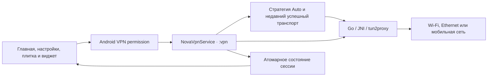

# Архитектура Nova Android Enhanced

Nova управляет VPN через Android `VpnService`. Kotlin владеет согласованием с ОС, выбором транспорта, наблюдением за сессией и интерфейсом. Обработка пакетов выполняется существующими нативными движками.

## Запуск и переключение

- `NovaVpnService` управляет поколениями попыток, TUN, сокетами и восстановлением после изменения сети. При завершении шага Auto поколение инвалидируется до ожидания потока. Очередь конечная, новая попытка в ней использует существующую процедуру запуска выбранного транспорта.
- `SmartNetworkPolicy` получает доступный набор транспортов и подсказки Android. В стандартной сети WARP и MASQUE идут первыми. В неподтверждённой сети Auto пробует NOVA и Opera раньше WARP. История хранится сутки по типу сети и её состоянию, без идентификатора конкретной точки доступа.
- `SmartNetworkStore` записывает выбор пользователя из UI, а последнее подключение — из VPN-процесса. Отдельные атомарные файлы позволяют читать состояние между процессами.
- Ручной выбор, списки профилей, split tunneling и сетевой watchdog остаются в существующих маршрутах приложения. Политика Auto не смешивает импорт с публичным каталогом.
- Отчёт в настройках показывает системные признаки, наличие адресов и транспорт действующей сессии. Передача отчёта запускается вручную.

## Данные и транспорт

- **WARP / AmneziaWG / WireGuard.** Go-ядро взаимодействует с Android через gomobile и защищённые сокеты. Освобождение TUN и остановку движка координирует служба. В сборке Enhanced нет общей встроенной учётной записи WARP.
- **MASQUE.** Варианты CONNECT-IP находятся в Go-ядре. Успешное открытие сессии и рабочий путь для полезного трафика фиксируются отдельно.
- **NOVA / VLESS / Opera / Tor.** `nova-proxy` запускает Mihomo. VLESS обслуживает отдельный Xray через JNI. Прокси-ветки подключают TUN через tun2proxy. Наличие TCP-пути и поддержка UDP зависят от выбранного транспорта. Tor-выход не подходит для транзита произвольного UDP.
- **White.** Пользовательский DNS-туннель требует собственной конфигурации авторитативной зоны и сервера. Защищённый DNS для обычных запросов — отдельная часть приложения.
- **DNS.** Kotlin хранит правила и режим маршрутизации, Go обрабатывает запросы и апстримы. Исходные реализации DoH и DoT сохранены. В отчёте Private DNS отражает состояние Android для исходной сети. Это не проверка отсутствия утечек.

## Риски, найденные при аудите

- Upstream публиковал общий профиль WARP, ключи в строках проверенных шаблонов и учётные данные API-релея. Текущая сборка Enhanced использует публичные части шаблонов и не включает эти учётные данные. Историю проверяют отдельно до публикации.
- Импортированный VLESS мог передать Xray параметр `allowInsecure`. Генератор Enhanced устанавливает проверку сертификата независимо от этого параметра.
- `ClientData` хранит часть ключей и конфигураций в области приложения без отдельного слоя Keystore. Миграция требует тестов сохранения и восстановления из обоих процессов.
- Мобильный прокси, локальные правила DNS, раздельный туннель и режимы сторонних провайдеров имеют разные свойства. Системный экран Always-on и блокировка соединений вне VPN — отдельная возможность Android.
- Исходные Issues #18, #19, #23 и #24 описывают сообщения о реконнекте, нагреве, split tunneling и Android TV. Для закрытия каждого отчёта нужны воспроизводимые сценарии и подтверждение на устройстве. [Issues upstream](https://github.com/confeden/Nova-Android/issues)

## Go и Rust

Нативный путь уже сочетает Go, C++ JNI и Rust в tun2proxy. Сетевой планировщик работает при установлении сессии и не находится на пути обработки пакетов. Перед миграцией исследуйте копирование TUN, потоки Go и JNI, выделения памяти, CPU, энергию и нагрев по одной тестовой матрице. Смотрите [BENCHMARKS.md](BENCHMARKS.md).
